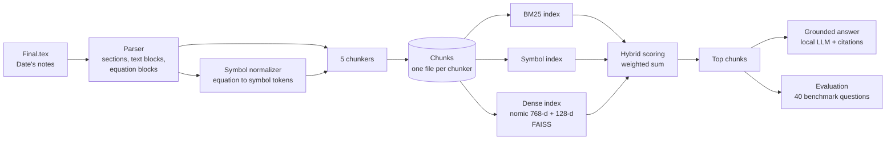
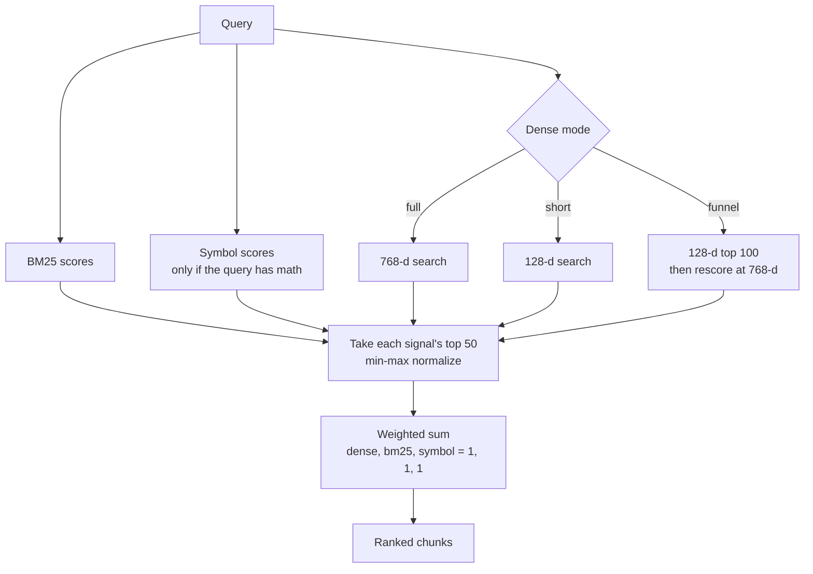
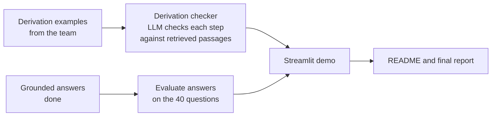

# QFT-RAG: project progress

CS410 project: **hybrid retrieval for theoretical-physics notes**. This file says what the project is, what is built, what we found so far, and what is left. Last updated 2026-11-09.

## 1. The idea

Quantum field theory notes are mostly LaTeX equations and derivations. Ordinary text search handles them badly: a plain text chunker cuts equations in half, a keyword search can't match `\partial_\mu \phi` against `\partial^\mu\phi`, and an embedding model blurs symbols together.

The project asks one question: **which way of chunking the notes, and which mix of search signals, retrieves the right passage best?**

We compare:

| Axis | Options |
|---|---|
| Chunking (5) | fixed, recursive, section, equation-aware, hierarchical |
| Search signal | BM25 (keywords), dense embeddings, symbol matching (math tokens), and combinations (hybrid) |
| Dense embeddings | full 768-d, short 128-d, or "Matryoshka funnel" (short shortlist, then full rescoring) |

Two terms, kept apart on purpose:
- **Matryoshka** means the embeddings: one model, vectors truncated to a short size for a fast shortlist, then rescored at full size.
- **Hierarchical** means nested chunking: sections contain derivations, which contain leaf chunks.

Corpus: G. Date, *Lectures on Introduction to Quantum Field Theory*, arXiv:2207.02243 (one LaTeX file, about 20,000 lines).

## 2. Pipeline



### How one query is scored



### How we judge a result

```mermaid
flowchart LR
    G[Benchmark question<br/>gold = source block IDs] --> H{Does a retrieved chunk<br/>contain a gold block?}
    R[Ranked chunks] --> H
    H -->|rank of first hit| M[Recall@1/3/5, MRR]
    H -->|within a token budget| T[Hit at 500 / 1000 / 2000 tokens]
```

Gold labels point to source blocks, not to chunk IDs, so every chunker is judged on the same ground truth. Plain recall favours huge chunks, so we also report the token-budget view.

## 3. Status

| Phase | What | Status |
|---|---|---|
| 1 | Fetch corpus, parser, symbol normalizer | Done |
| 2-3 | Five chunkers | Done |
| 4 | BM25, symbol, dense (Matryoshka), hybrid, FAISS indexes | Done |
| Benchmark | 40 labelled retrieval questions | Done |
| 5 | Evaluation: scoring, token budget, weight tuning, ablations | Done |
| 6a | Grounded answers with citations (Ollama) | Done, lightly tested |
| 6b | Derivation checker | **Not started**, needs the team's examples |
| 6c | Evaluate the answers on the 40 questions | Not started |
| 7 | Streamlit demo, README, final report | Not started |

### What is built

| Part | Where |
|---|---|
| Corpus download | `scripts/fetch_data.py` |
| Parser (sections, blocks, equations) | `src/parser/parser.py`, `schema.py` |
| Symbol normalizer | `src/parser/normalizer.py` |
| Five chunkers | `src/chunking/` (`fixed`, `recursive`, `section`, `equation`, `hierarchical`) |
| BM25, symbol, dense, hybrid | `src/retrieval/` |
| Benchmark | `scripts/build_benchmark.py` creates `data/benchmark/questions.json` |
| Evaluation | `src/evaluation/` (`retrieval_eval`, `budget_eval`, `tune`, `ablation`) |
| Grounded answers | `src/rag/answer.py`, `llm.py` |
| Tests | `tests/` (40 pass) |

Parsed corpus: 91 sections, 1,485 text blocks, 651 equations.

Chunk counts and how each chunker treats equations:

| Chunker | Chunks | Equations cut in half |
|---|---|---|
| fixed | 1,064 | 469 |
| recursive | 1,191 | 145 |
| section | 91 (median 2,500 tokens) | 0 |
| equation-aware | 1,315 | 0 |
| hierarchical | 2,073 (91 section, 449 derivation, 1,533 leaf) | 0 |

## 4. Results so far

The benchmark has 40 questions: 14 concept, 12 equation, 7 notation, 7 context. With 40 questions, one question is 2.5 points, so gaps under about 5 points are noise.

**Hit rate when every method gets 1,000 tokens of context (hybrid, equal weights):**

| Chunker | Hit @ 1000 tokens |
|---|---|
| recursive | 0.88 |
| fixed | 0.82 |
| equation-aware | 0.80 |
| hierarchical | 0.75 |
| section | 0.35 |

Findings:
1. **Section chunks only looked best on plain recall** because each is about 3,000 tokens. Under a fixed budget they are the worst.
2. **Hybrid beats any single signal.** Equal weights (1, 1, 1) are the default.
3. **Symbol matching helps equation questions** (hit@1000 from 0.53 without it to 0.78 with it) and adds nothing on concept questions.
4. **Dense search is the weakest signal** here, and near useless on equation questions.
5. **The Matryoshka funnel matches full 768-d dense search** and is slightly worse than short-only on a few chunkers. It saves compute but does not improve quality. We report it as a speed result.
6. **Tuning the weights did not help** on the held-out half of the questions (21 dev, 19 test). With so few questions it overfit.
7. **Q37 is found by no chunker.** The answer is one equation and its words match other sections better.

Raw results are in `data/processed/results_*.json` (not in git).

## 5. What is left

### Needs the team

| Task | What we need |
|---|---|
| **Derivation examples** (about 25) | For each: the derivation as LaTeX steps, whether it is correct, and if wrong which step and why. A mix of correct derivations and subtly wrong ones (sign error, dropped factor) works best. |
| Read the failures | Look at the failing questions in section 4 and say whether the benchmark label or the retrieval is at fault. |
| Report | Decide the structure and who writes which section once the demo exists. |

### Planned work



1. **Derivation checker.** Given a derivation, find the wrong step, using retrieved passages as evidence.
2. **Answer evaluation.** Run the 40 questions through answering and score whether the cited sources support each answer. The citation check only confirms a citation exists, not that it supports the sentence.
3. **Streamlit demo.** Ask a question, choose chunker and search method, see the sources and answer.
4. **README and report.**
5. **Optional:** second embedding model (`mxbai` is already defined) to check the dense results aren't specific to nomic.

## 6. How to run it

Setup uses [uv](https://docs.astral.sh/uv/) with Python 3.12. The corpus and everything under `data/processed/` is not in git, so rebuild it in this order:

```bash
uv sync
uv run python scripts/fetch_data.py                      # download the notes
uv run python -m src.parser.parser --report              # parse to data/processed/date_qft.json
uv run python -m src.parser.normalizer                   # fill equation symbols
uv run python -m src.chunking.run                        # write the five chunk files
uv run python -m src.retrieval.build --model nomic       # embed all chunks (a few minutes, cached)
PYTHONPATH=. uv run python scripts/build_benchmark.py    # regenerate the benchmark (already in git)

uv run python -m src.evaluation.retrieval_eval           # recall / MRR grid
uv run python -m src.evaluation.budget_eval              # token-budget view
uv run python -m src.evaluation.tune                     # weight tuning, dev vs test
uv run python -m src.evaluation.ablation                 # signal ablations and failures

uv run python -m src.rag.answer "What does Noether's theorem say?"   # needs Ollama running
uv run pytest                                            # 40 tests
```

The answering step uses [Ollama](https://ollama.com) with `granite4.2:8b`.

## 7. Notes for the team

- The dense model (nomic) needs `trust_remote_code`, and `transformers` is pinned below version 5 because of it.
- If you see a crash in FAISS, `src/retrieval/dense.py` already imports torch before faiss and runs FAISS single-threaded. Keep that order.
- The source notes are Date's. Don't commit them or excerpts of them; `data/raw/` and `data/processed/` are gitignored for that reason.
- `data/benchmark/questions.json` is committed. Its `status` is still `draft`; the labels were checked by script and by hand, not by a second person.
