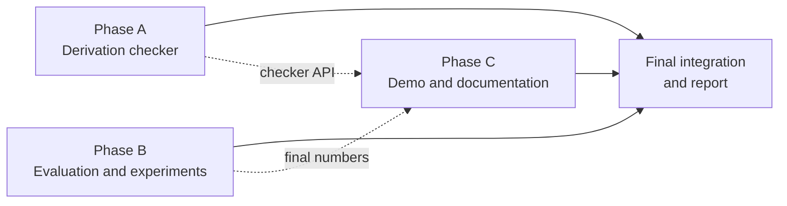

# QFT-RAG: remaining work, split into 3 phases

Three phases, one per teammate, designed to run **in parallel**. Read `progress.md` (status) and `implementation.md` (how everything works and what to keep fixed) before starting. Do not change the parser, chunkers or benchmark gold labels unless your task says so: that invalidates everyone else's results (see the checklist in `implementation.md` section 13).

Setup: `uv sync`, then rebuild the data with the commands in `implementation.md` section 9. Answering needs Ollama running with `granite4.2:8b`.



**Handoffs between phases** (agree these early, then work independently):
- Phase A exposes `check_derivation(steps, retriever, llm) -> CheckResult` in `src/rag/derivation.py` (Phase C calls it).
- Phase B writes final result tables to `data/processed/results_*.json` and a short summary to `results.md` (Phase C pulls numbers from it).
- Phase C should build the demo against the existing `Answerer` first, then add the checker tab when Phase A's function exists.

---

## Phase A: derivation checker

**Goal:** given a derivation written as LaTeX steps, find the first wrong step and explain why, using passages retrieved from Date's notes as evidence.

### A1. Write the derivation examples (about 25), in `data/benchmark/derivations.json`
Each example:

```json
{
  "id": "D01",
  "title": "Klein-Gordon from the action",
  "topic_section": "6",
  "steps": ["S[\\phi] = \\int d^4x [...]", "\\delta S = ...", "..."],
  "is_correct": false,
  "wrong_step": 3,
  "error_type": "sign | dropped factor | wrong index | wrong assumption | other",
  "explanation": "Why step 3 does not follow from step 2."
}
```

- Mix: about 12 correct derivations and 13 subtly wrong ones (one planted error each).
- Take correct derivations from Date's notes (section ids in `topic_section`), rewrite in your own words, then plant the error yourself. Keep the metric convention of the notes (mostly-plus, `eta = diag(-1,1,1,1)`).
- Cover a spread of topics: classical fields, Noether, Dirac, propagators, Compton, Ward identity, renormalization, path integrals.
- Have a second person check every example; the labels are the ground truth for the whole phase.

### A2. Build the checker, in `src/rag/derivation.py`
1. For each step, retrieve evidence with `Retriever.retrieve` (query = the step plus its topic). Use `recursive` chunks, hybrid, equal weights.
2. Ask the LLM (via `src/rag/llm.py`) whether step *n* follows from step *n-1* given the numbered evidence, and to cite sources like `answer.py` does.
3. Return a `CheckResult(first_wrong_step | None, per_step_verdicts, explanation, sources)`.
4. Reuse `answer.verify` ideas: reject explanations that cite nonexistent sources.
5. Add a `FakeLLM` unit test in `tests/test_derivation.py`.

### A3. Evaluate it, in `src/evaluation/derivation_eval.py`
Report: accuracy of "correct vs wrong", accuracy of the identified wrong step, and results by error type. Compare at least two options (for example evidence retrieval on vs off) so we can say whether retrieval helps.

**Done when:** examples reviewed and committed, checker passes tests, evaluation table written to `results.md`, and the known failure modes are described in a few sentences.

---

## Phase B: evaluation and experiments

**Goal:** finish the quantitative story: are the grounded answers good, and are the retrieval conclusions solid?

### B1. Evaluate the grounded answers
1. Write `src/evaluation/answer_eval.py`. For each of the 40 benchmark questions, run `Answerer` and save answer, sources and the mechanical verdict to `data/processed/answers.json`.
2. Hand-label a sample (at least 15 answers) for: **supported** (every claim backed by the cited source), **correct**, **refused when it should have answered**.
3. Report the share of answers that are grounded by the mechanical check versus supported by the hand labels. The gap is the finding (the check only proves a citation exists).
4. Compare two chunkers for answering (for example `recursive` vs `equation`).

### B2. Strengthen the retrieval results
1. **Second embedding model:** `uv run python -m src.retrieval.build --model mxbai`, then rerun the retrieval and budget evaluations for it. Does dense behave the same? (The evaluation scripts hard-code `nomic`; add a `--model` flag.)
2. **Funnel timing script:** commit a script in `src/evaluation/` that measures search time for full vs short vs funnel at 2k, 100k and 1M vectors. The measured figures are in `implementation.md` section 6 (about 5 to 6x at scale, no gain at our size).
3. **Failure analysis:** write up why Q37, Q01, Q07, Q12, Q14, Q29 and Q34 fail (list from `python -m src.evaluation.ablation`). For each: wrong label, wrong chunk, or a real retrieval weakness?
4. **Benchmark robustness:** add about 10 questions phrased like a student would ask (not copying the notes' wording), with gold anchors that follow the rules in `implementation.md` section 7. Re-run the grid and report whether the ranking of chunkers changes. Have a second person check the new labels.

### B3. Write `results.md`
One page: final tables (Recall/MRR, token-budget, ablation, answer quality), three to five conclusions each tied to a table, and the caveats from `implementation.md` section 7. This is the source for the report.

**Done when:** `results.md` exists, scripts run from a clean checkout, and every number in it can be regenerated by a command listed in the file.

---

## Phase C: demo, documentation and report

**Goal:** a runnable demo, a README a stranger can follow, and the written report.

### C1. Streamlit demo, in `app/streamlit_app.py`
Add `streamlit` with `uv add streamlit`. Features:
- Question box, selectors for chunker and search method (including the dense mode), token-budget slider.
- Results panel: ranked chunks with section path, `Final.tex` line range, and per-signal scores (`Hit.signals`). Render LaTeX with `st.latex` or markdown math.
- Answer panel: calls `Answerer`, shows the answer with citations and a "grounded / not grounded" badge.
- Derivation tab: paste steps, call Phase A's `check_derivation`, show the verdict (start with a stub until A2 lands).
- Cache the retriever and the embedding model with `st.cache_resource` so the page is fast after the first load.
- Add a small "compare chunkers" view that runs one query through all five and shows the top hit of each (this is the project's point, so make it visible).

### C2. README
Rewrite `README.md`: one-paragraph aim, a screenshot or GIF of the demo, quick start (the commands from `implementation.md` section 9), repo layout, how to run the tests, the source credit to Date and arXiv:2207.02243, and the note that the notes themselves are not redistributed.

### C3. Final report (outline; fill in with Phase B's `results.md`)
1. Problem and motivation (why QFT notes are hard to search).
2. Corpus and parsing.
3. The five chunkers and the two proposed methods.
4. Retrieval signals, Matryoshka funnel, hybrid fusion.
5. Benchmark and metrics, including the token-budget argument.
6. Results and analysis (from `results.md`).
7. Grounded answers and derivation checking.
8. Limitations and future work (take from `implementation.md` section 12).
9. Team contributions and reproducibility.

### C4. Cleanup
- Remove or archive the obsolete review scripts (`scripts/build_review_page.py`, `scripts/build_review_xlsx.py`), then make sure `scripts/build_benchmark.py` and the tests still pass (the xlsx script imports from the page script; delete both together).
- Set `status` in `questions.json` to `reviewed` once a second person has checked the labels.
- Confirm `.gitignore` still excludes `data/raw/` and `data/processed/`.

**Done when:** `uv run streamlit run app/streamlit_app.py` works on a fresh machine following only the README, and the report draft covers every section above.

---

## Shared rules

- Run `uv run pytest` before every commit. Add tests for new logic; use `FakeLLM` and the fake embedder for tests, never a live model.
- Small commits, one phase's files at a time, to avoid merge conflicts: Phase A touches `src/rag/derivation.py`, `data/benchmark/derivations.json`; Phase B touches `src/evaluation/`, `results.md`; Phase C touches `app/`, `README.md`, the report.
- Anything that changes block IDs or chunking is out of scope for all three phases. If you think it is needed, raise it with the team first.
- Never commit Date's text (`data/raw`, `data/processed`, spreadsheet exports of passages).
- Keep the two terms apart in all writing: **Matryoshka** = embeddings, **hierarchical** = nested chunking.
